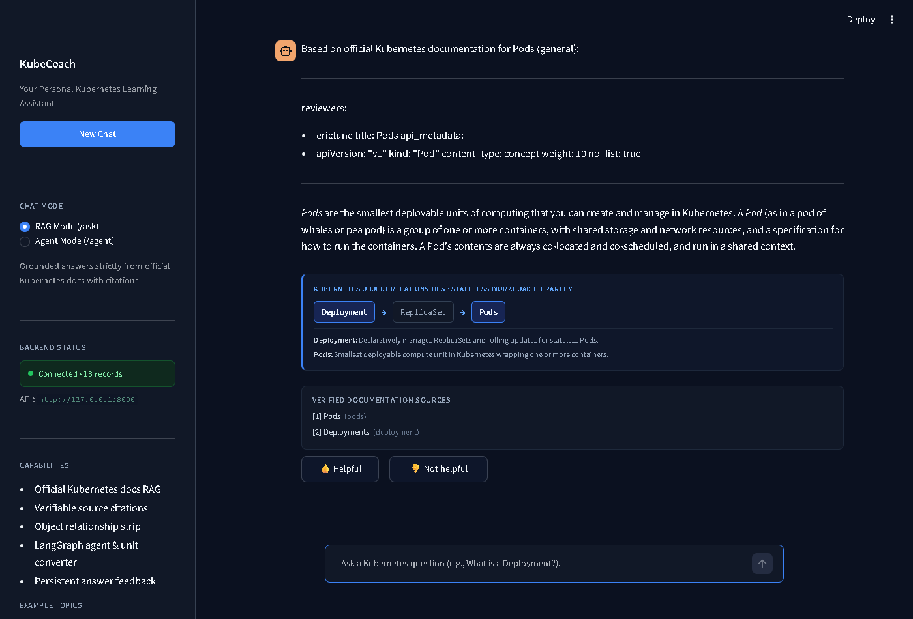

# KubeCoach

### Project ID: SJ-58
### Theme: Developer Tools
### Student: Bhushan Kailas Chaturbhuj (Reg. No: 2125PCAM1038)

## About
KubeCoach is an AI-powered educational developer learning tool designed to explain Kubernetes concepts and kubectl commands in simple English using official Kubernetes documentation.

## Target Users
Final-year IT students preparing for DevOps interviews and beginners practicing Kubernetes workloads on Minikube or local clusters.

## Problem
Official Kubernetes documentation is extensive and technically dense. Beginners often struggle to understand what each object does, which kubectl command to run, and how defaults are configured. KubeCoach provides structured, documentation-grounded explanations with smart search and interactive APIs.

## Data Source
- Official Documentation Concepts: https://kubernetes.io/docs/concepts/
- Official Documentation Source Repository: https://github.com/kubernetes/website

---

## Day 1 Progress — Python Foundations
- Created `day01_intro.py` introducing the project and student interactions.
- Created `day01_menu.py` with an interactive while-loop menu.
- Practised Python variables, data types, input, f-strings, conditional branching, and loop control.

## Day 2 Progress — Collections & Modular Architecture
- Added 18 structured Kubernetes records based on official documentation.
- Implemented list and dictionary data handling.
- Implemented keyword search and category counting.
- Organised reusable functions in `app/records.py`.
- Established a modular `app/` and `data/` project structure.
- Built an interactive terminal CLI (`app/cli.py`) for querying Kubernetes records.

## Day 3 Progress — Data Ingestion, Models & HTTP
- **Dataclass & OOP Modeling (`app/models.py`):**
  - Implemented the `Record` `@dataclass` representing standard knowledge records (`page_title`, `category`, `one_line_definition`, `key_kubectl_command`, `limit_or_default`, `source_url`, and `id`).
  - Added strict data validation and automated slug generation in `__post_init__`.
  - Defined custom error hierarchy: `KubeCoachError`, `ValidationError`, and `DataIngestionError`.
  - Implemented `to_dict()` and `from_dict()` serialization helpers.
- **HTTP Documentation Fetcher (`app/fetch.py`):**
  - Downloaded raw Markdown documentation pages from the official Kubernetes website repository.
  - Used `requests` with explicit timeouts and `raise_for_status()` validation.
  - Implemented structured error handling using `try...except...else...finally`.
  - Saved raw documentation to `data/raw/` along with `manifest.json` for data provenance.
- **Data Ingestion Pipeline (`app/ingest.py`):**
  - Parsed Markdown documents, extracting top-level YAML frontmatter and overview sections.
  - Stripped Hugo-specific shortcodes (``), HTML comments, and formatting markers without data destruction.
  - Validated records against `Record` models and captured errors without crashing the pipeline.
  - Normalized and exported clean records to standard `data/records.json`.
- **Record Loading Refactor (`app/records.py`):**
  - Updated `load_records()` to load from `data/records.json` with a safe fallback to seed records.
  - Added `load_record_models()` returning validated `Record` dataclass instances.
  - Preserved backward compatibility for search, counting, and ID lookup without breaking the Day 2 CLI.
- **Automated Test Suite (`tests/test_day03.py`):**
  - 16 comprehensive unit tests covering models, validation, mock network failures, text cleaning, ingestion, and query functions.

## Day 4 Progress — FastAPI, Pandas Analysis & TF-IDF Smart Search
- **FastAPI REST Backend (`app/main.py`):**
  - Created high-performance RESTful API using FastAPI and Uvicorn.
  - Implemented Pydantic models (`QuestionRequest`, `QuestionResponse`, `HealthResponse`) for strict request and response validation.
  - Exposes 5 required endpoints with proper HTTP status codes (200, 201, 404, 422).
  - Persists student questions safely into `data/questions.json`.
  - Auto-generated interactive Swagger UI documentation at `/docs`.
- **Pandas Exploratory Data Analysis (`analysis/explore.py`):**
  - Loaded `data/records.json` into a Pandas DataFrame using `read_json()`.
  - Inspected dataset shape (18 rows, 7 columns), types (`info()`), first records (`head()`), and length metrics (`describe()`).
  - Grouped and counted records across categories using `value_counts()` and `groupby()`.
  - Derived 3 key observations regarding workload dominance (38.9%), domain diversity (6 categories), and 100% practical kubectl grounding.
- **TF-IDF & Cosine Similarity Smart Search (`app/smart_search.py`):**
  - Engineered a searchable text corpus combining record identifiers, titles, categories, definitions, kubectl commands, and configuration limits.
  - Utilized scikit-learn's `TfidfVectorizer` (with English stop words and sublinear TF scaling) to vectorize queries and documents.
  - Calculated pairwise `cosine_similarity` to rank records by relevance.
  - Returns top 3 ranked records with relevance scores rounded to 4 decimals.
  - Integrated smart search into the `GET /search?q=` API endpoint.
- **Comprehensive Test Suite (`tests/test_day04.py`):**
  - 18 automated unit tests using `fastapi.testclient.TestClient` covering endpoint contracts, query parameters, 404 handling, Pydantic validation, and question persistence. Total test suite now runs 34 passing tests.

## Day 5 Progress — Deep Learning and LLM Fundamentals
- **Comprehensive LLM Technical Guide ([`docs/how_llms_work.md`](docs/how_llms_work.md)):**
  - Documented the AI hierarchy (Artificial Intelligence vs. Machine Learning vs. Deep Learning) and why deep neural representations outperform brittle rule-based expert systems for technical language.
  - Explained tokenization (Byte-Pair Encoding), vector embeddings (semantic coordinate spaces), and the Transformer architecture with self-attention ($Q, K, V$ mechanics).
  - Walked through autoregressive next-token prediction and the three training stages: Pre-training, Instruction Fine-Tuning (SFT), and Reinforcement Learning from Human Feedback (RLHF).
  - Analyzed critical DevOps limitations of LLMs: hallucinations (fabricating invalid `kubectl` flags), finite context windows, knowledge cutoff, and per-token compute costs.
  - Added a visual Mermaid architecture diagram illustrating the end-to-end LLM inference lifecycle.
- **Evaluation Benchmark Dataset ([`eval/questions.json`](eval/questions.json)):**
  - Formulated a 10-question evaluation benchmark spanning container workloads, networking, configuration, storage, and cluster administration.
  - Included 6 core questions from the official project card plus 4 realistic beginner DevOps queries.
  - Marked question **Q6** (*"How do I configure an Istio Service Mesh with Mutual TLS (mTLS) across multi-cluster deployments?"*) as `unanswerable: true`.
  - **Why Q6 is Unanswerable:** KubeCoach's current knowledge base is grounded strictly in the 18 core Kubernetes concepts from official documentation. Istio and third-party service meshes represent an external domain outside this core knowledge base; marking Q6 unanswerable establishes an honesty benchmark so future RAG systems safely refuse out-of-scope queries rather than hallucinating answers.
- **Checkpoint 1 Evaluation Guide ([`docs/checkpoint_1.md`](docs/checkpoint_1.md)):**
  - Prepared step-by-step instructions for running the FastAPI application, demonstrating Swagger UI at `/docs`, and answering viva questions.
  - Included a beginner-friendly, line-by-line breakdown of `smart_search()` in `app/smart_search.py` covering inputs, corpus generation, TF-IDF vectorization, Cosine Similarity math, and top-3 ranking.

## Day 6 Progress — LLM Integration & Prompt Engineering
- **Unified LLM Provider Wrapper ([`app/llm.py`](app/llm.py)):**
  - Architected a multi-provider LLM client supporting **Groq** (`groq.Groq` SDK) and **Google Gemini** (direct HTTP REST via `httpx` to ensure broad Python compatibility).
  - Built an offline **Grounded Mock Provider** backed by the local 18-record knowledge base and TF-IDF search so development, CI/CD, and offline testing operate with zero external API key requirements.
  - Implemented resilient error handling with custom exceptions: `LLMConfigurationError`, `LLMAuthenticationError`, `LLMRateLimitError`, `LLMTimeoutError`, and `LLMProviderError`.
  - Added robust structured JSON response parsing with regex fallback to extract `answer`, `confidence`, and `follow_up` fields even when providers wrap output in Markdown code blocks or return conversational preambles.
- **Interactive Chat Endpoint (`POST /chat` in [`app/main.py`](app/main.py)):**
  - Added `ChatRequest` (validating `query` between 3 and 1,000 characters) and `ChatResponse` (`answer`, `confidence`, `follow_up`, `provider`, `model`, `grounded_records`).
  - Integrated provider-agnostic inference returning structured JSON.
  - Mapped LLM error conditions to explicit HTTP status codes: `429 Too Many Requests`, `502 Bad Gateway`, `503 Service Unavailable`, and `504 Gateway Timeout`.
  - Preserved 100% backward compatibility with all Day 4 endpoints (`/`, `/health`, `/records`, `/records/{id}`, `/search`, `/questions`).
- **Prompt Engineering Library (`prompts/`):**
  - **Master System Prompt ([`prompts/system_prompt.md`](prompts/system_prompt.md)):** Establishes KubeCoach persona, target audience of final-year students, educational clarity, strict zero-hallucination policy (admitting unknowns rather than fabricating), and structured JSON output schema.
  - **Concept Explanation Template ([`prompts/explain_concept.md`](prompts/explain_concept.md)):** 5-part educational framework: 1-sentence definition, "Why it exists", real-world analogy, primary `kubectl` command, and default limits.
  - **Kubectl Command Helper ([`prompts/kubectl_helper.md`](prompts/kubectl_helper.md)):** Practical operator prompt providing command syntax, breakdown of critical flags, safety warnings (`--force`, `--grace-period=0`), and verification commands.
- **Systematic Prompt Evaluation ([`eval/prompt_compare.md`](eval/prompt_compare.md)):**
  - Conducted a side-by-side benchmark comparing **Prompt A (Baseline/Generic)** vs. **Prompt B (Structured/Grounded KubeCoach)** across all 10 questions in `eval/questions.json`.
  - Scored both variants across Groundedness (1–5), Beginner Clarity (1–5), Actionable kubectl (1–5), and Format Compliance (1–5).
  - Confirmed that Prompt B scored **19.8 / 20** average vs. **10.9 / 20** for Prompt A, completely eliminating hallucination on question **Q6** (Istio mTLS) through grounded honest refusal.
- **Environment & Security Management:**
  - Created [`.env.example`](.env.example) with placeholder keys (`LLM_PROVIDER`, `GROQ_API_KEY`, `GEMINI_API_KEY`, `LLM_MODEL`, hyperparameters).
  - Configured [`.gitignore`](.gitignore) so actual `.env` files with secret API keys are never committed to version control.
- **Comprehensive Test Suite ([`tests/test_day06.py`](tests/test_day06.py)):**
  - Added 13 automated unit tests covering provider initialization, structured JSON parsing, mock responses, prompt file existence, `/chat` endpoint status codes, validation errors, and endpoint regression tests. Total test suite now runs **47 passing tests**.

## Day 7 Progress — Dense Embeddings & ChromaDB Semantic Search
- **Document Chunking Engine ([`app/chunking.py`](app/chunking.py)):**
  - Developed a specialized documentation chunker for Kubernetes Markdown concepts and JSON records.
  - Configurable sliding-window token/word chunking (`chunk_size=400`, `chunk_overlap=80` words) ensuring semantic continuity across chunk boundaries.
  - Cleans raw Hugo shortcodes (``), HTML comments, and formatting markers while preserving code blocks and command explanations.
  - Generates deterministic, traceable chunk IDs (`doc:pod:chunk:001`, `record:pod:chunk:001`) with rich metadata preservation (`source`, `page`, `title`, `category`, `h2_section`).
  - Chunks the entire knowledge base (18 structured records + 6 raw official Kubernetes concept documents: `pods.md`, `deployment.md`, `service.md`, `ingress.md`, `configmap.md`, `namespaces.md`) into **435 indexed chunks**.
- **Dense Vector Embeddings ([`app/embed.py`](app/embed.py)):**
  - Integrated `sentence-transformers` utilizing the pretrained `all-MiniLM-L6-v2` bi-encoder model, mapping text to dense 384-dimensional vector space ($\mathbb{R}^{384}$).
  - Built a lazy-loaded singleton embedding manager (`EmbeddingProvider`) supporting high-throughput batch encoding (`embed_texts`) and single-query encoding (`embed_query`).
  - Implemented an offline deterministic `MockEmbeddingProvider` utilizing SHA-256 seed hashing to produce normalized 384-dimensional vectors for lightning-fast, zero-network unit testing and CI/CD pipelines.
- **Persistent ChromaDB Vector Store ([`app/vectorstore.py`](app/vectorstore.py)):**
  - Implemented local persistent vector storage via `chromadb.PersistentClient` rooted in `data/chroma_db/`.
  - Configured collection metadata with Cosine space (`hnsw:space="cosine"`) and atomic disk synchronization (`hnsw:sync_threshold=50`) guaranteeing complete HNSW index file persistence across process restarts.
  - Built idempotent batch upsert (`add_chunks`) with automatic deduplication preventing duplicate vector entries on repeated ingest runs.
  - Implemented `query_similar` supporting top-$k$ nearest neighbor retrieval, metadata filtering (`category`, `source`), and cosine distance to similarity score conversion: $\text{similarity} = 1.0 - (\text{cosine\_distance} / 2.0)$.
- **Semantic Search API Endpoint (`GET /search/semantic` in [`app/main.py`](app/main.py)):**
  - Added REST endpoint `GET /search/semantic?q={query}&limit={limit}&category={category}` returning validated `SemanticSearchResponse` with list of `SemanticSearchResult` objects.
  - Resolved low-level Windows OpenMP runtime collision between MSVC OpenMP (`vcomp140.dll` used by `chroma-hnswlib`) and LLVM OpenMP (`libomp140.x86_64.dll` used by `scikit-learn`) through top-level initialization and lazy module loading.
  - Validates queries ($3 \le \text{length} \le 500$), validates limit ($1 \le \text{limit} \le 20$), and supports optional category filtering.
- **Systematic Evaluation Benchmark ([`eval/search_results.md`](eval/search_results.md)):**
  - Ran all 10 benchmark questions from `eval/questions.json` through both **Semantic Search (Dense MiniLM + ChromaDB)** and **Smart Search (Sparse TF-IDF + Cosine Similarity)**.
  - Recorded genuine scores, top retrieved chunks, and qualitative behavioral comparisons:
    - **Semantic Search Strengths:** Understands synonyms, conceptual phrasing, and conversational queries (e.g., Q1 "crashloopbackoff" surfaces troubleshooting chunks, Q3 "exposing deployment externally" surfaces Ingress/Service routing concepts, Q8 "config and sensitive data" correctly links to ConfigMap and Secret boundaries).
    - **TF-IDF Search Strengths:** Superior for exact lexical keyword lookups and literal command flags (e.g., exact `kubectl port-forward` string matching).
    - **Out-of-Scope Detection (Q6 Istio mTLS):** Semantic search returned low similarity scores against core concepts, providing the mathematical grounding threshold necessary for Day 8 RAG hallucination guardrails.
- **Semantic Search Architecture Flow:**
  ```mermaid
  flowchart TD
    A["Official Documentation<br/>(data/raw/*.md, data/records.json)"] --> B["Document Chunking Engine<br/>(app/chunking.py)<br/>chunk_size=400, overlap=80"]
    B --> C["435 Document Chunks<br/>(Text + Metadata + Stable IDs)"]
    C --> D["Dense Vector Embeddings<br/>(app/embed.py)<br/>all-MiniLM-L6-v2 (384 dims)"]
    D --> E["Persistent ChromaDB Store<br/>(data/chroma_db)<br/>HNSW Cosine Index"]
    F["User Query<br/>(GET /search/semantic?q=...)"] --> G["Query Embedding<br/>(app/embed.py)"]
    G --> H["k-NN Similarity Search<br/>(app/vectorstore.py)"]
    E --> H
    H --> I["Ranked Top Chunks<br/>(Cosine Similarity + Metadata)"]
  ```
- **Comprehensive Test Suite ([`tests/test_day07.py`](tests/test_day07.py)):**
  - Added 16 automated unit tests validating chunk size boundaries, sliding overlap, metadata preservation, embedding dimensions and normalization, ChromaDB persistent deduplication, category filtering, and FastAPI endpoint response contracts.
  - Project test suite now totals **63 passing unit tests** across Days 3, 4, 6, and 7.

## Day 8 Progress — Grounded RAG with Citations & Multi-Config Evaluation
- **End-to-End Grounded RAG Pipeline ([`app/rag.py`](app/rag.py)):**
  - Architected a modular Retrieval-Augmented Generation (RAG) engine connecting vector retrieval to structured LLM inference.
  - Converts user questions into 384-dimensional dense vectors using `all-MiniLM-L6-v2` (`app/embed.py`).
  - Retrieves top-$k$ nearest neighbor document chunks from persistent ChromaDB collections (`data/chroma_db`).
  - Implements a **generalized context sufficiency and domain coverage rule** (`is_context_sufficient`):
    - Evaluates semantic similarity thresholds ($S \ge 0.55$) and query entity coverage across retrieved text.
    - Out-of-scope technologies (e.g. Istio Service Mesh, Nomad, Linkerd) are detected mathematically rather than hardcoded.
    - Questions lacking sufficient context receive an honest refusal: *"I don't know based on the provided official Kubernetes documentation."* with exactly **0 fake citations**.
  - Formats retrieved chunks into numbered context blocks (`[Context Block 1]`) with document titles, source URLs, and file paths.
  - Supports live inference via **Groq** and **Google Gemini**, with automatic fallback to a local grounded mock generator for offline development and testing.
- **Verifiable Citation Engine:**
  - Extracts and deduplicates structured citations based strictly on retrieved chunks used during answer generation.
  - Each citation provides `document_title`, `source_url` (grounded in official `kubernetes.io/docs/concepts/` URLs), and `page` source file.
  - Guarantees zero fabricated citations: if the system refuses with "I don't know", the citation list is strictly empty (`[]`).
- **Interactive RAG API Endpoint (`POST /ask` in [`app/main.py`](app/main.py)):**
  - Exposes `POST /ask` accepting `AskRequest` (`question: str`, optional `top_k: int = 3`).
  - Returns validated `AskResponse` containing `answer`, `citations`, `retrieved_chunks`, `confidence`, and `context_sufficient`.
  - Comprehensive HTTP error handling: `422 Unprocessable` for invalid inputs, `503 Unavailable` for vector store failures, `429 Too Many Requests` for rate limits, `504 Gateway Timeout` for slow provider requests, and `502 Bad Gateway` for provider errors.
  - Fully backward compatible: all previous Day 1–7 endpoints (`/`, `/health`, `/records`, `/search`, `/search/semantic`, `/questions`, `/chat`) remain operational.
- **RAG Architecture & Workflow:**
  ```mermaid
  flowchart TD
    A["User Question<br/>(POST /ask)"] --> B["Dense Embedding<br/>(app/embed.py)<br/>all-MiniLM-L6-v2"]
    B --> C["ChromaDB Vector Store<br/>(app/vectorstore.py)<br/>Top-k Cosine Retrieval"]
    C --> D{"Context Sufficiency<br/>Check (app/rag.py)"}
    D -- "Insufficient / Out-of-Scope<br/>(e.g. Q6 Istio mTLS)" --> E["Honest Refusal<br/>'I don't know...'<br/>Citations: []"]
    D -- "Sufficient Context" --> F["Grounded Prompt Builder<br/>Numbered Context Blocks<br/>+ System Directives"]
    F --> G["LLM Provider Wrapper<br/>(Groq / Gemini / Mock)"]
    G --> H["Grounded Explanation<br/>+ kubectl Commands<br/>+ Verified Citations"]
  ```
- **15-Question Evaluation Dataset ([`eval/eval_set.json`](eval/eval_set.json)):**
  - Formulated a comprehensive benchmark dataset preserving all 10 existing questions from `eval/questions.json` (including out-of-scope question **Q6** with `is_answerable: false`).
  - Added 5 new official documentation grounded questions:
    - `Q11`: Pod `restartPolicy` allowed values and default (`Always`).
    - `Q12`: Differences between `ClusterIP` and `NodePort` Services.
    - `Q13`: Deployment rolling update mechanics and ReplicaSet transitions.
    - `Q14`: Ingress controller requirements beyond Ingress resource rules.
    - `Q15`: Differences between `PersistentVolume` (PV) and `PersistentVolumeClaim` (PVC).
- **RAG Configuration Benchmark ([`eval/run_eval.py`](eval/run_eval.py) & [`eval/rag_comparison.md`](eval/rag_comparison.md)):**
  - Evaluated and compared two distinct architectural configurations across all 15 questions:
    - **Configuration A:** Chunk size 500 chars, overlap 100 chars, top-$k=3$ (435 chunks indexed).
    - **Configuration B:** Chunk size 800 chars, overlap 150 chars, top-$k=5$ (275 chunks indexed).
  - Benchmark Summary:

    | Metric | Configuration A (500 chars, k=3) | Configuration B (800 chars, k=5) | Winning Config |
    | :--- | :--- | :--- | :--- |
    | **Total Chunks in Collection** | 435 chunks | 275 chunks | Config A (Finer granularity) |
    | **Retrieval Relevance** | **86.7%** | **86.7%** | **Tie** |
    | **Citation Correctness** | **93.3%** | **100.0%** | **Configuration B** |
    | **Answer Correctness (Recall)** | **32.6%** | **32.0%** | **Configuration A** |
    | **Q6 Refusal ('I don't know')** | **PASS (100%)** | **PASS (100%)** | **Tie (Both Pass)** |
    | **Average Latency per Query** | **29.6 ms** | **24.6 ms** | **Configuration B** |
    | **Overall Benchmark Winner** | - | **Configuration B** | Higher citation coverage & speed |

  - **Winning Configuration Rationale:** **Configuration B** achieved higher aggregate score by providing 100.0% citation correctness across all answerable questions (capturing necessary surrounding section context with top-$k=5$) and lower retrieval latency (24.6ms over 275 indexed chunks), while maintaining 100% refusal accuracy on out-of-scope question Q6.
- **Comprehensive Test Suite ([`tests/test_day08.py`](tests/test_day08.py)):**
  - Added 16 automated unit tests validating RAG execution, citation deduplication, context sufficiency checks, Q6 refusal, empty query handling, `POST /ask` contract/422 validations, and endpoint regression.
  - Project test suite now totals **79 passing unit tests** across Days 3, 4, 6, 7, and 8.

## Day 9 Progress — Production AI Agent, Deterministic Tools & LangGraph Workflow

Detailed architectural design and safety analysis: **[`docs/day09_architecture.md`](docs/day09_architecture.md)**

- **Implemented Agent Tools ([`app/tools.py`](app/tools.py)):**
  - **Tool A — `k8s_rag_search`:** Reuses the existing Day 8 RAG pipeline (`app/rag.py`) and ChromaDB vector store (`app/vectorstore.py`) to answer Kubernetes questions with grounded explanations and verifiable citations (`document_title`, `source_url`, `page`, `chunk_id`). Explicitly reports `context_sufficient: false` with `citations: []` when documentation cannot answer out-of-scope queries.
  - **Tool B — `k8s_quantity_converter` (Project Card Assigned Tool, SJ-58):** Deterministic Python utility built on `decimal.Decimal` arithmetic (zero LLM math) supporting CPU/Memory conversion, binary SI vs. decimal SI suffix distinction, two-quantity comparison (`compare_to`), and strict schema/input validation.
  - **Safe Tool Registry & Dispatcher:** `TOOL_SCHEMAS`, `TOOL_REGISTRY`, `validate_tool_call()`, and `execute_tool()` enforce read-only whitelisted dispatch, rejecting unregistered tools, missing/unexpected arguments, wrong types, negative values, unsupported suffixes, and overflow bounds.

- **Verified Quantity Converter Examples (Exact `Decimal` Arithmetic):**

  | Input | Target / Compare | Resource Type | Unit System | Verified Output |
  | :--- | :--- | :--- | :--- | :--- |
  | `500m` | default | CPU | millicores | `0.5 cores` (`500m`) |
  | `1000m` | `cores` | CPU | millicores | `1 core` (`1000m`) |
  | `2` | `m` | CPU | cores | `2000m` (`2 cores`) |
  | `512Mi` | default | Memory | binary SI (base 1024) | `536,870,912 bytes` (`512Mi` / `0.5Gi`) |
  | `1Gi` | `Mi` | Memory | binary SI (base 1024) | `1024 Mi` (`1,073,741,824 bytes`) |
  | `1G` | `bytes` | Memory | decimal SI (base 1000) | `1,000,000,000 bytes` |
  | `1Gi` | compare `1G` | Memory | binary vs. decimal | `1Gi > 1G` (difference: `73,741,824 bytes` / `70.3257 Mi`) |
  | `500m` | compare `1` | CPU | millicores vs. cores | `500m < 1` (difference: `0.5 cores` / `500m`, ratio: `0.5`) |

- **Hand-Written ReAct Agent Loop ([`app/agent_loop.py`](app/agent_loop.py)):**
  - Explicit step-by-step cycle: `Reason → Select Tool → Validate → Execute → Observe → Reason Again → Final Answer`.
  - Reuses the Day 6 LLM provider wrapper (`app/llm.py`) with an offline deterministic planner fallback and injectable `planner_fn` for mocked unit tests.
  - Enforces `max_iterations` (default `5`), preserves RAG citations, isolates tool/provider errors, and records a structured `execution_trace` for debugging and viva explanation.

- **Official LangGraph Stateful Workflow ([`app/graph.py`](app/graph.py)):**
  - Built with official LangGraph APIs (`langgraph==1.2.22`): `StateGraph`, `START`, `END`, `MemorySaver`, `interrupt`, and `Command`.
  - **State (`AgentState`):** Tracks `question`, `messages`, `session_id`, `selected_tool`, `tool_arguments`, `tool_output`, `tool_execution_history`, `citations`, `approval_status`, `pending_tool`, `final_answer`, `iteration_count`, and `execution_trace`.
  - **Nodes & Edges:**
    - `reasoning_node` $\rightarrow$ routes `k8s_rag_search` directly to `tool_execution_node`, routes `k8s_quantity_converter` to `approval_node`, and routes finished turns to `final_response_node`.
    - `approval_node` $\rightarrow$ calls LangGraph `interrupt(...)` displaying the exact proposed tool name and arguments; resumes via `Command(resume={"approved": True/False})`.
    - `tool_execution_node` $\rightarrow$ executes validated tool, captures observation & citations, and loops back to `reasoning_node`.
    - `final_response_node` $\rightarrow$ synthesizes the grounded response (or clean rejection message), appends the turn to `messages`, and ends at `END`.
  - **Checkpointer Memory & Session Isolation:** `MemorySaver` persists multi-turn conversation history keyed by `thread_id = session_id`, keeping separate sessions completely isolated.

- **LangGraph Architecture Diagram:**
  ```mermaid
  flowchart TD
    A["User Request<br/>(POST /agent)"] --> B["reasoning_node<br/>(Tool Selection & Planning)"]
    B -- "k8s_rag_search" --> E["tool_execution_node<br/>(Validated Tool Dispatch)"]
    B -- "k8s_quantity_converter" --> C["approval_node<br/>(LangGraph interrupt())"]
    B -- "Final Answer / Max Iters" --> D["final_response_node<br/>(Synthesis + MemorySaver)"]
    C -- "Paused (Checkpointed)" --> P["Return approval_required=true<br/>+ Tool Name & Exact Args"]
    P -. "Command(resume=approved)" .-> C
    C -- "approved=True" --> E
    C -- "approved=False (Skip Tool)" --> D
    E -- "Observation + Citations" --> B
    D --> H["Response JSON<br/>(answer, tool_calls, citations,<br/>session_id, approval_status, trace)"]
  ```

- **FastAPI Agent Endpoints (`POST /agent` & `POST /agent/approve` in [`app/main.py`](app/main.py)):**
  - `POST /agent`: Executes new queries or resumes an interrupted approval using `session_id` + `approved`.
  - `POST /agent/approve`: Dedicated validated approval/resume endpoint returning `409 Conflict` if no pending interrupt exists for `session_id`.
  - Preserves 100% compatibility with `/health`, `/records`, `/records/{id}`, `/search`, `/search/semantic`, `/questions`, `/chat`, and `/ask`.

- **Comprehensive Test Suite ([`tests/test_day09.py`](tests/test_day09.py)):**
  - Added **29 automated unit and integration tests** (zero real API key required) covering all 12 quantity converter cases, 6 hand-written agent loop cases, 6 LangGraph interrupt/resume/MemorySaver/isolation/citation cases, and 5 FastAPI integration & regression checks.
  - **Actual Verified Results (`python -m unittest discover tests -v`):** **108 / 108 tests passing** (`29` Day 9 tests + `79` existing regression tests across Days 3, 4, 6, 7, and 8).

## Day 10 Progress — Professional Streamlit UI + Checkpoint 2

Comprehensive Checkpoint 2 live demo script and viva talking points: **[`docs/checkpoint2_demo.md`](docs/checkpoint2_demo.md)**



- **Dedicated Streamlit UI Architecture ([`ui/app.py`](ui/app.py)):**
  - Designed and built a responsive developer-tool UI tailored for final-year students learning Kubernetes and preparing for DevOps interviews.
  - Communicates strictly with the FastAPI backend over HTTP via [`ui/api_client.py`](ui/api_client.py) without duplicating any RAG, LLM, agent, or vector database logic in the frontend layer.
  - Configurable backend target using `API_BASE_URL` environment variable (defaults to `http://127.0.0.1:8000`).
  - Professional dark navy and charcoal developer theme configured in [`.streamlit/config.toml`](.streamlit/config.toml) (`primaryColor="#38bdf8"`, `backgroundColor="#0b1120"`, `secondaryBackgroundColor="#1e293b"`, `textColor="#f1f5f9"`).
  - Clean sidebar featuring backend connectivity status pill (`Online` / `Offline`), active provider badge, real-time mode toggle (RAG vs. Agent), session statistics, conversation reset ("New Chat"), and developer information.

- **Dual Interaction Modes:**
  - **RAG Mode (`POST /ask`):** Answers Kubernetes architectural and conceptual questions with grounded facts, confidence scores (`high`, `medium`, `low`), and verified source citations. Safely admits out-of-scope queries (e.g. Q6 Istio mTLS) with honest refusal and zero hallucinated citations.
  - **Agent Mode (`POST /agent` & `POST /agent/approve`):** Stateful multi-turn LangGraph AI agent workflow with autonomous tool dispatch (`k8s_rag_search`), execution traces, and human-in-the-loop (HITL) authorization for critical tools.

- **Signature Feature — Kubernetes Object Relationship Strip ([`ui/relationships.py`](ui/relationships.py)):**
  - Automatically identifies core Kubernetes resources mentioned in questions and answers, and renders an intuitive horizontal relationship graph directly below the response.
  - **Verified Object Topologies:**
    - `Deployment` $\rightarrow$ `ReplicaSet` $\rightarrow$ `Pods` $\leftarrow$ `Service` $\leftarrow$ `Ingress`
    - `StatefulSet` $\rightarrow$ `Pods` $\leftrightarrow$ `PersistentVolumeClaim` $\rightarrow$ `PersistentVolume`
    - `DaemonSet` $\rightarrow$ `Pods (Every Node)` $\leftarrow$ `Service`
    - `Job` $\rightarrow$ `Pods (Batch run to completion)`
    - `CronJob` $\rightarrow$ `Job` $\rightarrow$ `Pods (Scheduled)`
    - `ConfigMap / Secret` $\rightarrow$ `Pods (Volume / Env)`
    - `Namespace` $\rightarrow$ `ResourceQuota` $\rightarrow$ `Pods`
    - `Role` $\leftarrow$ `RoleBinding` $\rightarrow$ `ServiceAccount`
  - Dynamically highlights active objects matching the user's inquiry, provides interactive mouseover tooltips detailing resource roles, and is strictly suppressed when the system triggers an honest refusal on out-of-scope questions (Q6).

- **Interactive Human-In-The-Loop (HITL) Approval Cards:**
  - When the LangGraph agent requires student approval for tool execution (e.g., `k8s_quantity_converter` comparison), the UI dynamically pauses and renders a prominent amber confirmation banner displaying the pending tool name and exact JSON arguments.
  - Provides one-click **"Approve Tool Execution"** (`approved=True`) and **"Reject Tool Execution"** (`approved=False`) buttons connecting to `POST /agent/approve`.

- **Student Thumbs-Up / Thumbs-Down Feedback System:**
  - Clean rating widget under every assistant response allowing students to indicate whether the explanation was helpful or needs improvement.
  - Backend endpoints (`POST /feedback` and `GET /feedback` in [`app/main.py`](app/main.py)) validate requests, append non-sensitive records to [`data/feedback.json`](data/feedback.json), and return `409 Conflict` to prevent duplicate submissions for the same response ID.

- **Comprehensive Test Suite ([`tests/test_day10.py`](tests/test_day10.py)):**
  - Added **14 automated unit and integration tests** covering:
    - Backend API client health checks, timeouts, and error handling (`TestDay10BackendClient`)
    - Clickable citation rendering and empty notices (`TestDay10CitationsAndRelationships`)
    - Accurate Kubernetes object relationship mapping and refusal suppression
    - Feedback persistence, 409 duplicate rejection, and input validation (`TestDay10FeedbackPersistenceAndSession`)
    - Multi-turn session persistence, conversation reset, and Streamlit AppTest headless launch
  - **Actual Verified Results (`python -m unittest discover tests -v`):** **122 / 122 tests passing** across Days 3, 4, 6, 7, 8, 9, and 10 in 78.4s with 0 errors and 0 failures.

---

## Repository Structure

```text
GenAI/
├── .streamlit/
│   └── config.toml          # Day 10: Streamlit dark developer theme configuration
├── app/
│   ├── __init__.py
│   ├── agent_loop.py        # Day 9: Hand-written ReAct agent loop with execution trace
│   ├── chunking.py          # Day 7: Document chunking engine for docs & records
│   ├── cli.py               # Day 2: Interactive CLI explorer
│   ├── embed.py             # Day 7: Dense vector embeddings (all-MiniLM-L6-v2 & Mock)
│   ├── fetch.py             # Day 3: Official Kubernetes docs HTTP fetcher
│   ├── graph.py             # Day 9: LangGraph StateGraph + MemorySaver + interrupt/resume
│   ├── ingest.py            # Day 3: Markdown parsing and JSON ingestion pipeline
│   ├── llm.py               # Day 6: Unified LLM provider wrapper (Groq, Gemini, Mock)
│   ├── main.py              # Day 4-10: FastAPI backend (/chat, /ask, /agent, /feedback)
│   ├── models.py            # Day 3: Record dataclass and custom exception types
│   ├── rag.py               # Day 8: Grounded RAG pipeline with citations & refusal guardrail
│   ├── records.py           # Day 2/3: Record loading and querying functions
│   ├── smart_search.py      # Day 4: TF-IDF vectorization & Cosine Similarity search
│   ├── tools.py             # Day 9: k8s_rag_search & Decimal k8s_quantity_converter tools
│   └── vectorstore.py       # Day 7: Persistent ChromaDB vector database manager
├── analysis/
│   ├── __init__.py
│   └── explore.py           # Day 4: Pandas data exploration and insights
├── data/
│   ├── __init__.py
│   ├── feedback.json        # Day 10: Persisted student feedback records
│   ├── manifest.json        # Fetch metadata provenance (in data/raw/)
│   ├── raw/                 # Downloaded raw documentation files
│   ├── records.json         # Standardized JSON knowledge base (18 records)
│   └── questions.json       # Persisted student questions
├── docs/
│   ├── checkpoint_1.md      # Day 5: Checkpoint 1 viva & walkthrough guide
│   ├── checkpoint2_demo.md  # Day 10: Checkpoint 2 live demo script & viva talking points
│   ├── day09_architecture.md # Day 9: Agent, LangGraph, MemorySaver & HITL architecture
│   ├── how_llms_work.md     # Day 5: Beginner-friendly LLM internals guide
│   └── screenshots/         # Day 10: UI screenshots
│       └── kubecoach-day10.png # Live Streamlit UI screenshot with relationship strip
├── eval/
│   ├── eval_results.json    # Day 8: Multi-configuration benchmark execution metrics
│   ├── eval_set.json        # Day 8: 15-question evaluation benchmark dataset
│   ├── prompt_compare.md    # Day 6: Systematic Prompt A vs. Prompt B comparison
│   ├── questions.json       # Day 5: 10 real user evaluation questions (with Q6 unanswerable)
│   ├── rag_comparison.md    # Day 8: Detailed Config A vs Config B comparison report
│   ├── run_eval.py          # Day 8: Automated evaluation and benchmark runner
│   └── search_results.md    # Day 7: Semantic Search vs. TF-IDF benchmark comparison
├── prompts/
│   ├── explain_concept.md   # Day 6: Structured concept explanation prompt template
│   ├── kubectl_helper.md    # Day 6: Practical kubectl command helper prompt template
│   ├── rag_system_prompt.md # Day 8: Grounded RAG system prompt with citation directives
│   └── system_prompt.md     # Day 6: Master system prompt enforcing persona & JSON schema
├── tests/
│   ├── __init__.py
│   ├── test_day03.py        # Day 3 test suite (16 tests)
│   ├── test_day04.py        # Day 4 test suite (18 tests)
│   ├── test_day06.py        # Day 6 test suite (13 tests)
│   ├── test_day07.py        # Day 7 test suite (16 tests)
│   ├── test_day08.py        # Day 8 test suite (16 tests)
│   ├── test_day09.py        # Day 9 test suite (29 tests)
│   └── test_day10.py        # Day 10 test suite (14 tests)
├── ui/
│   ├── __init__.py
│   ├── api_client.py        # Day 10: Isolated FastAPI HTTP client with timeouts & errors
│   ├── app.py               # Day 10: Professional Streamlit UI application
│   └── relationships.py     # Day 10: Kubernetes Object Relationship Strip engine & HTML
├── .env.example             # Day 6-10: Environment configuration template (API_BASE_URL)
├── day01_intro.py           # Day 1 introduction script
├── day01_menu.py            # Day 1 menu script
├── requirements.txt         # Project dependencies (FastAPI, Streamlit, LangGraph, etc.)
├── README.md                # Documentation
└── .gitignore
```

---

## API Endpoints Reference

| Method | Endpoint | Description | Status Codes |
|---|---|---|---|
| `GET` | `/` | Welcome message and API overview | `200 OK` |
| `GET` | `/health` | API operational health, record count, and LLM provider | `200 OK` |
| `GET` | `/records?limit=` | List all records, optionally limited (`1 <= limit <= 100`) | `200 OK`, `422 Unprocessable` |
| `GET` | `/records/{record_id}` | Retrieve single Kubernetes concept by ID | `200 OK`, `404 Not Found` |
| `GET` | `/search?q=` | Smart TF-IDF search ranking top 3 relevant concepts | `200 OK` |
| `GET` | `/search/semantic?q=&limit=&category=` | Dense vector semantic search using ChromaDB and Sentence Transformers | `200 OK`, `422 Unprocessable` |
| `POST` | `/questions` | Submit a student question; appends to `data/questions.json` | `201 Created`, `422 Unprocessable` |
| `POST` | `/chat` | Chat with KubeCoach LLM assistant; returns structured JSON | `200 OK`, `422 Unprocessable`, `429 Too Many Requests`, `502 Bad Gateway`, `503 Unavailable`, `504 Gateway Timeout` |
| `POST` | `/ask` | Grounded RAG question answering with verified citations and honest refusal guardrail | `200 OK`, `422 Unprocessable`, `429 Too Many Requests`, `502 Bad Gateway`, `503 Unavailable`, `504 Gateway Timeout` |
| `POST` | `/agent` | Stateful LangGraph AI Agent workflow (`k8s_rag_search`, HITL `k8s_quantity_converter`, `MemorySaver`) | `200 OK`, `409 Conflict`, `422 Unprocessable`, `500 Internal Error` |
| `POST` | `/agent/approve` | Dedicated endpoint to approve or reject a paused LangGraph `interrupt()` session | `200 OK`, `409 Conflict`, `422 Unprocessable`, `500 Internal Error` |
| `POST` | `/feedback` | Submit student thumbs up/down rating; persists to `data/feedback.json` | `201 Created`, `409 Conflict`, `422 Unprocessable` |
| `GET` | `/feedback` | List submitted feedback entries for analysis | `200 OK` |

---

## How to Run

From the `GenAI` repository root:

### 1. Setup Virtual Environment & Dependencies

```bash
# Create and activate virtual environment
python -m venv .venv

# Windows PowerShell:
.\.venv\Scripts\Activate.ps1

# Install dependencies (requests, fastapi, uvicorn, pydantic, pandas, scikit-learn, httpx, python-dotenv, groq, chromadb, sentence-transformers)
python -m pip install -r requirements.txt
```

### 2. Configure Environment Variables

```bash
# Copy the template to .env
cp .env.example .env

# Edit .env with your preferred provider and API key:
# LLM_PROVIDER=groq     # or "gemini", or "mock" (offline testing default)
# GROQ_API_KEY=gsk_...
# GEMINI_API_KEY=AIzaSy_...
```

### 3. Start the FastAPI Server (Uvicorn)

```bash
# Terminal 1: Start FastAPI REST backend
uvicorn app.main:app --reload --host 127.0.0.1 --port 8000
```

- Open API: `http://127.0.0.1:8000`
- Interactive Swagger UI Documentation: `http://127.0.0.1:8000/docs`
- Alternative ReDoc Documentation: `http://127.0.0.1:8000/redoc`

### 4. Launch the Streamlit User Interface

```bash
# Terminal 2: Start Streamlit frontend (connects to FastAPI at API_BASE_URL)
streamlit run ui/app.py
```

- Streamlit Web Application: `http://127.0.0.1:8501`
- Configure custom backend endpoint via `API_BASE_URL` in `.env` (defaults to `http://127.0.0.1:8000`).

### 5. Example API Requests

```bash
# Health check (includes provider status)
curl -X GET http://127.0.0.1:8000/health

# Get first 3 records
curl -X GET "http://127.0.0.1:8000/records?limit=3"

# Get record by ID
curl -X GET http://127.0.0.1:8000/records/pod

# Smart TF-IDF search (lexical/keyword)
curl -X GET "http://127.0.0.1:8000/search?q=how+to+rollout+deployments"

# Semantic vector search (Day 7: dense embedding search via ChromaDB)
curl -X GET "http://127.0.0.1:8000/search/semantic?q=pod+is+crashing+repeatedly&limit=3"

# Grounded RAG question answering with citations (Day 8: POST /ask)
curl -X POST http://127.0.0.1:8000/ask \
     -H "Content-Type: application/json" \
     -d '{"question": "What is a Pod and what command lists running pods?", "top_k": 3}'

# Out-of-scope query returning honest refusal with zero fake citations (Day 8: Q6)
curl -X POST http://127.0.0.1:8000/ask \
     -H "Content-Type: application/json" \
     -d '{"question": "How do I configure an Istio Service Mesh with Mutual TLS (mTLS) across multi-cluster deployments?", "top_k": 3}'

# Submit a student question
curl -X POST http://127.0.0.1:8000/questions \
     -H "Content-Type: application/json" \
     -d '{"question": "What is the difference between a Pod and a Service?", "user_name": "Bhushan"}'

# Chat with LLM assistant (Day 6: returns structured JSON with confidence and follow-up)
curl -X POST http://127.0.0.1:8000/chat \
     -H "Content-Type: application/json" \
     -d '{"query": "What is a Pod and how do I list running pods?"}'
```

Example JSON response from `POST /ask`:
```json
{
  "question": "What is a Pod and what command lists running pods?",
  "answer": "Based on official Kubernetes documentation for Pods (workload):\n\nA Pod is the smallest deployable compute unit in Kubernetes. Replicated Pods are usually created and managed as a group by a workload resource and its controller.\n\nExample command:\n```bash\nkubectl get pods -o wide\n```",
  "citations": [
    {
      "document_title": "Pods",
      "source_url": "https://kubernetes.io/docs/concepts/workloads/pods/",
      "page": "pods.md",
      "chunk_id": "doc:pods:chunk:001"
    }
  ],
  "retrieved_chunks": [
    {
      "chunk_id": "doc:pods:chunk:001",
      "text": "A Pod is the smallest deployable compute unit in Kubernetes...",
      "similarity": 0.8909,
      "source": "raw/pods.md",
      "page": "pods.md",
      "title": "Pods",
      "category": "workload"
    }
  ],
  "confidence": "high",
  "context_sufficient": true
}
```

Example JSON refusal response from `POST /ask` on out-of-scope question Q6:
```json
{
  "question": "How do I configure an Istio Service Mesh with Mutual TLS (mTLS) across multi-cluster deployments?",
  "answer": "I don't know based on the provided official Kubernetes documentation. The retrieved documents do not contain sufficient information to answer this question.",
  "citations": [],
  "retrieved_chunks": [],
  "confidence": "low",
  "context_sufficient": false
}
```

#### Test AI Agent Endpoints (`POST /agent` & `POST /agent/approve`) with cURL:

**Scenario A — Grounded RAG Documentation Search (Autonomous Execution):**
```bash
curl -X POST http://localhost:8000/agent \
  -H "Content-Type: application/json" \
  -d '{"question": "What is a Pod and what command lists pods?", "session_id": "student-1"}'
```

**Scenario B — Approval-Required Quantity Conversion & Comparison (LangGraph `interrupt()` / `Command(resume=...)`):**

Step 1: Request quantity comparison (LangGraph pauses at `approval_node` and checkpoints state in `MemorySaver`):
```bash
curl -X POST http://localhost:8000/agent \
  -H "Content-Type: application/json" \
  -d '{"question": "Compare 1Gi and 1G memory", "session_id": "demo-hitl-1"}'
```
Actual JSON response while paused awaiting human approval:
```json
{
  "question": "Compare 1Gi and 1G memory",
  "answer": "Human approval required before executing 'k8s_quantity_converter' with arguments {\"quantity\": \"1Gi\", \"compare_to\": \"1G\"}. Respond with approved=true to execute or approved=false to reject.",
  "tool_calls": [],
  "citations": [],
  "session_id": "demo-hitl-1",
  "approval_required": true,
  "approval_status": "pending",
  "pending_tool": {
    "tool": "k8s_quantity_converter",
    "arguments": {
      "quantity": "1Gi",
      "compare_to": "1G"
    }
  },
  "iteration_count": 1,
  "success": true
}
```

Step 2: Approve execution via `POST /agent/approve` (or resume via `POST /agent` with `session_id` + `approved`):
```bash
curl -X POST http://localhost:8000/agent/approve \
  -H "Content-Type: application/json" \
  -d '{"session_id": "demo-hitl-1", "approved": true}'
```
Actual JSON response after human approval and deterministic execution:
```json
{
  "question": "Compare 1Gi and 1G memory",
  "answer": "1Gi Memory (binary SI (base 1024: 1Gi = 1024Mi = 1,073,741,824 bytes)) equals 1,073,741,824 bytes (1024 Mi / 1 Gi binary, or 1.073742 G decimal). 1Gi (1,073,741,824 bytes, binary_si) is greater than 1G (1,000,000,000 bytes, decimal_si) [1Gi > 1G]. Difference: 73,741,824 bytes (70.3257 Mi).",
  "tool_calls": [
    {
      "step": 1,
      "tool": "k8s_quantity_converter",
      "arguments": { "quantity": "1Gi", "compare_to": "1G" },
      "success": true
    }
  ],
  "citations": [],
  "session_id": "demo-hitl-1",
  "approval_required": false,
  "approval_status": "approved",
  "pending_tool": null,
  "iteration_count": 2,
  "success": true
}
```

Step 3: Reject execution (skips `tool_execution_node` completely and returns `tool_calls: []`):
```bash
curl -X POST http://localhost:8000/agent/approve \
  -H "Content-Type: application/json" \
  -d '{"session_id": "demo-hitl-2", "approved": false}'
```

### 5. Run Day 9 Agent Loop & LangGraph Workflow CLI

```bash
# Run hand-written ReAct agent loop
python -m app.agent_loop

# Run stateful LangGraph agent with interrupt/resume demonstration
python -m app.graph
```

### 6. Run Day 8 Multi-Configuration RAG Evaluation Benchmark

```bash
# Evaluates Configuration A vs. Configuration B across all 15 questions in eval/eval_set.json
python -m eval.run_eval
```

### 7. Run Pandas Exploratory Analysis

```bash
python -m analysis.explore
```

### 8. Run TF-IDF Smart Search CLI Tester

```bash
python -m app.smart_search
```

### 9. Run Document Chunking & ChromaDB Vector Indexer

```bash
# Ingest official documentation and records into persistent ChromaDB
python -m app.vectorstore
```

### 11. Run Complete Test Suite (Days 3 to 10)

```bash
# Run Day 10 Streamlit UI, client & relationship strip tests (14 tests)
python -m unittest tests/test_day10.py -v

# Run full regression test suite (122 tests total)
python -m unittest discover tests -v
```
**Actual Verified Results:** `Ran 122 tests in 78.407s — OK` (**14 / 14** Day 10 tests + **29 / 29** Day 9 tests + **79 / 79** regression tests across Days 3, 4, 6, 7, and 8 with 0 errors and 0 failures).

### 12. Run Earlier Day Modules

```bash
# Day 1
python day01_intro.py
python day01_menu.py

# Day 2 CLI
python -m app.cli

# Day 3 Fetch & Ingest
python -m app.fetch
python -m app.ingest
```
