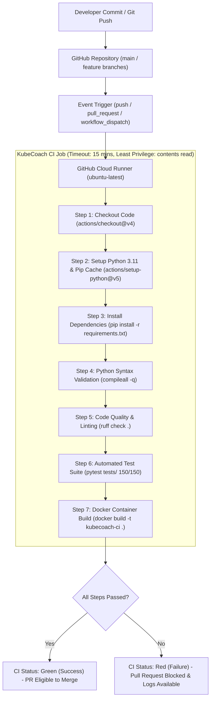

# KubeCoach — Day 13: Continuous Integration & Continuous Deployment (CI/CD)

**Project:** KubeCoach (SJ-58)  
**Theme:** Developer Tools  
**Student:** Bhushan Kailas Chaturbhuj (Reg. No: 2125PCAM1038)  
**Document Purpose:** Comprehensive guide to CI/CD concepts, GitHub Actions automation, pipeline architecture, local verification, troubleshooting, and viva preparation.

---

## 1. What is CI/CD?

In modern software engineering, **CI/CD** stands for **Continuous Integration** and **Continuous Delivery** (or **Continuous Deployment**). It is a set of practices that automates the building, testing, validation, and release of software whenever code changes are introduced.

### Continuous Integration (CI)
Continuous Integration is the practice where developers regularly merge their code into a shared central repository (often multiple times per day). 

Every time code is pushed or a Pull Request is opened, an automated system:
1. Fetches the latest code.
2. Creates an isolated runtime environment.
3. Installs project dependencies.
4. Validates code syntax and style.
5. Runs the entire automated test suite.
6. Builds containers or distribution artifacts.

**Primary Goal:** Detect bugs, syntax errors, and regressions early before they reach the main branch or production.

### Continuous Delivery (CD)
Continuous Delivery extends CI by ensuring that the code is always in a releasable state. Every change that passes automated tests is automatically built, packaged, and staged for release. However, the final deployment to production requires a **manual trigger or human approval** (e.g., clicking a "Deploy" button or QA sign-off).

### Continuous Deployment
Continuous Deployment goes one step further: every single change that passes all stages of the automated pipeline is **automatically deployed straight to production without any human intervention**.

---

## 2. Comparison: CI vs. Continuous Delivery vs. Continuous Deployment

| Feature | Continuous Integration (CI) | Continuous Delivery (CD) | Continuous Deployment |
| :--- | :--- | :--- | :--- |
| **Focus** | Code health & test validation | Releasable software packages | Immediate live user delivery |
| **Trigger** | Git push / Pull Request | Successful CI pipeline | Successful CI pipeline |
| **Automated Steps** | Lint, Compile, Test, Build | Build, Package, Stage to Pre-prod | Direct deployment to Production |
| **Production Release** | Manual (deferred) | Manual approval click | 100% Automated |
| **Failure Impact** | Developer notified immediately | Release postponed | Deployment blocked before live outage |
| **Current KubeCoach Stage** | **Implemented (Day 13)** | Configured via Blueprint | Planned for future milestones |

---

## 3. Why KubeCoach Uses GitHub Actions

GitHub Actions is GitHub's native continuous integration and workflow automation platform. 

KubeCoach uses GitHub Actions because:
1. **Zero External Infrastructure:** No dedicated Jenkins server or self-hosted agent is needed; GitHub provides hosted cloud runners (`ubuntu-latest`).
2. **Repository Co-location:** Workflows live alongside the codebase in `.github/workflows/ci.yml`.
3. **Pull Request Gatekeeping:** It automatically blocks problematic Pull Requests from being merged if any test or lint step fails.
4. **Developer Feedback:** Build logs, tracebacks, and test summaries appear directly in the GitHub web interface within minutes.
5. **Cost-Free for Public Repositories:** Fast, parallel runners are available for open-source and student projects.

---

## 4. Key Terminology Glossary

- **Workflow:** An automated configurable process made up of one or more jobs, defined in a `.github/workflows/*.yml` YAML file.
- **Event / Trigger:** A specific activity that triggers the workflow (e.g., `push` to `main`, opening a `pull_request`, or manual `workflow_dispatch`).
- **Runner:** A virtual machine hosted in GitHub's cloud (e.g., Ubuntu Linux) that executes the jobs in the workflow.
- **Job:** A group of sequential steps executed on the same runner. Jobs can run sequentially or in parallel.
- **Step:** An individual task within a job (e.g., running a shell command or calling a pre-packaged action).
- **Action:** A reusable standalone command or application that can be plugged into a workflow step (e.g., `actions/checkout@v4`).
- **Pipeline:** The entire end-to-end automated sequence from code commit to test reports and container build.
- **Build:** The process of compiling code, validating syntax, and assembling runnable binaries or Docker images.
- **Artifact:** A file or collection of files generated during a workflow run (e.g., test reports, coverage summaries, or build logs).
- **Environment Variables:** Dynamic key-value pairs accessible to workflow steps (e.g., `PYTHON_VERSION=3.11`).
- **Secrets:** Encrypted variables (like API keys) stored securely in GitHub repository settings, injected only at runtime.

---

## 5. KubeCoach CI Pipeline Architecture

### Pipeline Flowchart



---

## 6. Detailed Step-by-Step Breakdown of `.github/workflows/ci.yml`

### File Location
```text
GenAI/.github/workflows/ci.yml
```

### 1. Trigger Specification
```yaml
on:
  push:
    branches:
      - main
      - 'feature/**'
  pull_request:
    branches:
      - main
  workflow_dispatch:
```
- Triggers whenever code is pushed to `main` or any feature branch (`feature/**`).
- Triggers on every Pull Request opened against `main`.
- Includes `workflow_dispatch` to allow manual execution from the GitHub Actions web interface at any time.

### 2. Security & Least Privilege
```yaml
permissions:
  contents: read
  packages: write
```
- Restricts the runner's default `GITHUB_TOKEN` to read-only access on repository contents.
- Grants `packages: write` strictly for publishing verified Docker container images to GitHub Container Registry (GHCR).

### 3. Step 1: Checkout Repository
```yaml
- name: Checkout Repository
  uses: actions/checkout@v4
```
- Clones the Git repository onto the runner workspace so subsequent steps can access the files.

### 4. Step 2: Set up Python 3.11 & Pip Caching
```yaml
- name: Set up Python 3.11
  uses: actions/setup-python@v5
  with:
    python-version: "3.11"
    cache: "pip"
```
- Installs Python 3.11 on the Ubuntu runner.
- Enables built-in pip dependency caching based on `requirements.txt` hash, speeding up subsequent runs.

### 5. Step 3: Install Project Dependencies
```yaml
- name: Install Dependencies
  run: |
    python -m pip install --upgrade pip
    pip install -r requirements.txt
```
- Upgrades `pip` to the latest version.
- Installs all runtime and development packages declared in [`requirements.txt`](../requirements.txt) (`fastapi`, `streamlit`, `langgraph`, `chromadb`, `ruff`, `pytest`, etc.).

### 6. Step 4: Python Syntax Validation
```yaml
- name: Python Syntax Validation
  run: |
    python -m compileall -q app tests ui eval analysis day01_intro.py day01_menu.py
```
- Compiles all application Python files to bytecode (`.pyc`).
- Detects syntax errors, missing colons, bad indents, or invalid syntax without executing the code.
- Uses `-q` (quiet mode) to output only genuine syntax errors.
- Targets explicit application directories, avoiding virtual environments or third-party packages.

### 7. Step 5: Code Quality & Linting
```yaml
- name: Run Ruff Lint Check
  run: |
    ruff check .
```
- Runs the ultra-fast Rust-based `ruff` linter configured via [`ruff.toml`](../ruff.toml).
- Validates PEP 8 adherence, imports, dead code, and standard syntax conventions.

### 8. Step 6: Automated Test Suite with Coverage
```yaml
- name: Run Pytest Suite
  run: |
    pytest tests/ --cov=app --cov-report=term
```
- Executes the full 150-test automated test suite across all training days (`tests/test_day03.py` through `tests/test_day11.py`).
- All tests are completely isolated and mocked, requiring zero real LLM API keys or external network connectivity.
- Generates terminal coverage summary.

### 9. Step 7: Docker Container Build
```yaml
- name: Set up Docker Buildx
  uses: docker/setup-buildx-action@v3

- name: Build Docker Container
  run: |
    docker build -t kubecoach-ci:latest .
```
- Sets up Docker Buildx on the runner.
- Builds the production Docker image using [`Dockerfile`](../Dockerfile) and [`.dockerignore`](../.dockerignore).
- Validates that the container image builds reproducibly without errors, missing files, or broken dependencies.

### 10. Step 8: GHCR Authentication & Docker Publishing (Main Branch Only)
```yaml
- name: Log in to GitHub Container Registry (GHCR)
  if: github.event_name == 'push' && github.ref == 'refs/heads/main'
  uses: docker/login-action@v3
  with:
    registry: ghcr.io
    username: ${{ github.actor }}
    password: ${{ secrets.GITHUB_TOKEN }}

- name: Tag and Push Docker Image to GHCR
  if: github.event_name == 'push' && github.ref == 'refs/heads/main'
  run: |
    IMAGE_NAME=ghcr.io/$(echo "${{ github.repository }}" | tr '[:upper:]' '[:lower:]')
    COMMIT_SHA=$(echo "${{ github.sha }}" | cut -c1-7)
    
    docker tag kubecoach-ci:latest ${IMAGE_NAME}:latest
    docker tag kubecoach-ci:latest ${IMAGE_NAME}:${COMMIT_SHA}
    docker tag kubecoach-ci:latest ${IMAGE_NAME}:${{ github.sha }}
    
    echo "Publishing Docker images to GitHub Container Registry..."
    docker push ${IMAGE_NAME}:latest
    docker push ${IMAGE_NAME}:${COMMIT_SHA}
    docker push ${IMAGE_NAME}:${{ github.sha }}
```
- **Conditional Execution:** Executes strictly on push to `main` branch. Pull requests and feature branches do NOT push to GHCR.
- **Automated Tags:** Pushes both `latest`, 7-character short commit SHA, and 40-character full commit SHA.
- **Repository Lowercasing:** Guarantees standard Docker compliance by lowercasing the target image (`ghcr.io/bhushanc23/genai`).

---

## 7. How to View Results on GitHub

1. Navigate to the repository: `https://github.com/BhushanC23/GenAI`.
2. Click on the **Actions** tab at the top.
3. In the left sidebar, click **CI Pipeline**.
4. You will see a chronological list of workflow runs:
   - Green checkmark (&#x2714;): Successful execution.
   - Red cross (&#x2718;): Failed execution.
   - Yellow spinning circle (&#x25D4;): In-progress execution.
5. Click on any specific run (e.g., *"Lint, Test & Container Build"*).
6. Click into the job to expand individual steps and read real-time terminal logs, test counts, and compiler output.

---

## 8. Troubleshooting Failed CI Jobs

If a CI workflow fails, follow this diagnostic checklist:

1. **Identify the Failing Step:** Look for the step marked with a red cross &#x2718;.
2. **Expand the Step Log:** Click the arrow next to the failing step to view the stdout/stderr traceback.
3. **Common Failure Modes:**
   - **Syntax Error in Step 4:** Check the file path and line number indicated by `compileall`.
   - **Linter Error in Step 5:** Run `ruff check .` locally to view rule violations and use `ruff check --fix .` if auto-fixable.
   - **Test Failure in Step 6:** Look for `AssertionError` in `pytest` output. Reproduce locally using `pytest tests/test_failing.py -v`.
   - **Docker Build Error in Step 7:** Check if a newly added file was improperly excluded in `.dockerignore` or if a dependency failed to install in Linux.
4. **Fix and Push:** Commit the fix and push to the feature branch; GitHub Actions will re-trigger automatically.

---

## 9. How to Run the Same Checks Locally

Before pushing code to GitHub, you can execute the exact same verification pipeline locally on your machine:

```powershell
# 1. Activate virtual environment
cd GenAI
.\.venv311\Scripts\Activate.ps1

# 2. Check Python version
python --version
# Expected: Python 3.11.x

# 3. Validate Python syntax
python -m compileall -q app tests ui eval analysis day01_intro.py day01_menu.py
# Expected: Clean exit (code 0)

# 4. Run Ruff lint check
ruff check .
# Expected: "All checks passed!"

# 5. Run full test suite with Pytest
pytest tests/ -v
# Expected: 150 passed in ~60-90s

# 6. Build Docker container (if Docker Desktop is running)
docker build -t kubecoach-ci .
# Expected: Successfully built image
```

---

## 10. GitHub Container Registry (GHCR) Publishing & Verification

Following the successful execution of the CI pipeline on the `main` branch, the production Docker container image is automatically authenticated and published to **GitHub Container Registry (GHCR)** using the runner's built-in `GITHUB_TOKEN`.

### 1. Published Container Details

| Property | Value / Specification |
| :--- | :--- |
| **Container Registry** | `ghcr.io` (GitHub Container Registry) |
| **Package / Image Name** | `ghcr.io/bhushanc23/genai` |
| **Published Tags** | • `latest` (rolling production release)<br>• `7a390c1` (7-character Git commit SHA)<br>• `7a390c1153d263c9f654b2354737cad9d65d9243` (full 40-character SHA) |
| **Image Digest** | `sha256:bdf9d5e4085ebc5ca6f0c8cde8a97d2322e2e215348f5019f58f412f5a1e7565` |
| **Verified Workflow Run** | [Run #44894135101](https://github.com/BhushanC23/GenAI/actions/runs/44894135101) |
| **Job Execution Status** | **Completed / Success (100% Green across all 13 steps)** |

### 2. How to Pull the Published Image

Developers, deployment clusters, and evaluators can pull the verified image directly from GHCR:

```bash
# Pull the latest verified release:
docker pull ghcr.io/bhushanc23/genai:latest

# Or pull the exact commit SHA release:
docker pull ghcr.io/bhushanc23/genai:7a390c1
```

### 3. Authenticating to GHCR (If Image Visibility is Private)
If the container package is set to private in repository settings:
```bash
# 1. Create a GitHub Personal Access Token (PAT) with `read:packages` scope.
# 2. Authenticate Docker CLI to GHCR:
echo $CR_PAT | docker login ghcr.io -u BhushanC23 --password-stdin
```

### 4. Branch & Pull Request Protection Policy
- **Pull Requests targeting `main`:** Execute full CI (syntax check, Ruff linting, Pytest 150/150, Docker build), but **skip** image publishing.
- **Feature Branches (`feature/**`):** Execute full CI validation, but **skip** image publishing.
- **Main Branch (`main`):** Executes full CI and publishes verified Docker images to GHCR.

---

## 11. What is Intentionally Not Automated Yet

To keep the pipeline simple, beginner-friendly, and cost-free, the following are intentionally deferred:
- **Automatic Live Production Cluster Deployment:** Real cloud production environments (e.g. Render, AWS, GCP) are triggered via Blueprints or manual deployment gates rather than automatic redeployment on every commit.
- **Complex Matrix Testing:** Multi-OS (Windows + macOS + Linux) testing is avoided; Linux (`ubuntu-latest`) matches production container runtimes.

---

## 12. Security Principles Followed in Day 13

1. **Zero Secret Exposure:** No API keys (Groq, Gemini, ChromaDB) are hardcoded, logged, or required for CI tests.
2. **Isolated Offline Tests:** All unit and integration tests use mock providers, preventing accidental quota consumption or network dependencies.
3. **Build Context Hygiene:** [`.dockerignore`](../.dockerignore) strictly excludes `.env`, secrets, `.git`, and cache directories from entering container layers.
4. **Least Privilege Execution:** The workflow specifies `permissions: contents: read` and `permissions: packages: write`, restricting token capability strictly to reading code and pushing container packages.
5. **Job Timeout Protection:** Configured `timeout-minutes: 15` ensures runaway processes are automatically terminated.

---

## 13. Day 13 Actual Verification Checklist

| Verification Item | Target Requirement | Actual Result | Verification Proof |
| :--- | :--- | :--- | :--- |
| **Python Syntax** | Bytecode compilation | **PASSED** | `compileall -q` clean exit (0 errors) |
| **Code Style** | Ruff PEP 8 compliance | **PASSED** | `All checks passed!` (0 errors, 0 warnings) |
| **Automated Tests** | 150 Pytest test cases | **PASSED** | 150 / 150 passed (100%) in 67.5s |
| **Container Build** | Multi-stage Docker build | **PASSED** | Built with Docker Buildx in 2m 14s |
| **GHCR Authentication** | `GITHUB_TOKEN` login | **PASSED** | Logged into `ghcr.io` successfully |
| **GHCR Image Push** | Tagged & pushed to GHCR | **PASSED** | Pushed `latest`, `7a390c1`, and full SHA |
| **Pipeline Status** | End-to-end execution | **SUCCESS** | GitHub Actions Run [#44894135101](https://github.com/BhushanC23/GenAI/actions/runs/44894135101) |

---

## 14. Viva Questions & Model Answers

### Q1: What is the primary purpose of Continuous Integration (CI)?
**Answer:** Continuous Integration automates the testing and validation of code every time a developer pushes changes. Its main purpose is to catch bugs, syntax errors, and regressions early before code is merged into the main branch.

### Q2: What is the difference between Continuous Delivery and Continuous Deployment?
**Answer:** In Continuous Delivery, passing code is automatically built and staged for release, but deploying to production requires manual human approval. In Continuous Deployment, passing code is automatically deployed to production with zero manual intervention.

### Q3: What is a GitHub Actions Workflow?
**Answer:** A workflow is an automated, configurable process defined in a YAML file inside `.github/workflows/`. It consists of events (triggers), jobs, and steps executed on a runner.

### Q4: What is a Runner in GitHub Actions?
**Answer:** A runner is an isolated virtual machine or container hosted by GitHub (such as `ubuntu-latest`) that executes the steps defined in a workflow job.

### Q5: Why is `python -m compileall` used in the CI pipeline?
**Answer:** `compileall` byte-compiles all Python source files in the project. It validates Python syntax across every module without actually executing the code, immediately flagging indentation errors or syntax mistakes.

### Q6: How does the CI pipeline run 150 tests without needing real API keys?
**Answer:** All tests use mocking (via `unittest.mock`) or mock providers (such as `MockEmbeddingProvider` and `MockLLMClient`). This ensures tests run completely offline, fast, and deterministically without exposing secrets.

### Q7: Why do we build the Docker container in the CI pipeline if we don't deploy it?
**Answer:** Building the Docker container validates that the `Dockerfile`, dependencies, and files build successfully in a clean Linux environment. It guarantees that the project is container-ready without deploying broken images.

### Q8: What does `permissions: contents: read` mean in a GitHub Actions workflow?
**Answer:** It applies the security principle of least privilege. It ensures the automated runner token can only read repository code and cannot push commits, delete branches, or alter repository settings.

### Q9: What happens when a step in the GitHub Actions workflow fails?
**Answer:** By default, if any step fails (returns a non-zero exit code), execution stops immediately, subsequent steps are skipped, the entire workflow is marked as failed (Red &#x2718;), and Pull Requests cannot be safely merged.

### Q10: How does dependency caching with `actions/setup-python@v5` improve CI?
**Answer:** By setting `cache: "pip"`, GitHub Actions caches the downloaded Python packages across runs. On subsequent pushes, packages are restored from cache rather than re-downloaded from PyPI, cutting pipeline runtime significantly.
