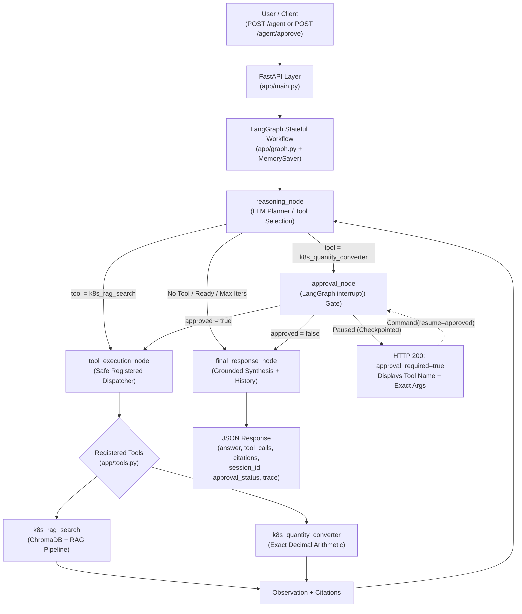

# KubeCoach — Day 9 Agent & LangGraph Architecture

**Project:** KubeCoach (Project ID: SJ-58, Theme: Developer Tools)  
**Author:** Bhushan Kailas Chaturbhuj  
**Module Scope:** AI Agents, Structured Tool Calling, Hand-Written ReAct Loop, LangGraph Stateful Workflow, Checkpointer Memory, and Human-in-the-Loop (HITL) Approval

---

## 1. High-Level Agent Architecture

KubeCoach Day 9 extends the existing Day 1–8 architecture (FastAPI, Groq/Gemini LLM wrapper, SentenceTransformers embeddings, persistent ChromaDB vector store, and grounded RAG pipeline) with an autonomous agentic layer capable of selecting and executing deterministic tools safely.

Rather than duplicating any prior logic, the agent layer composes directly over existing modules:
- **Documentation grounding** reuses `app/rag.py` (`execute_rag_pipeline`) and `app/vectorstore.py` (`ChromaDB`).
- **LLM reasoning** reuses `app/llm.py` (`call_groq`, `call_gemini`, `generate_chat_response`).
- **API delivery** extends `app/main.py` with `POST /agent` and `POST /agent/approve` while preserving all existing endpoints (`/health`, `/records`, `/search`, `/search/semantic`, `/questions`, `/chat`, `/ask`).

### End-to-End Architecture Diagram



---

## 2. Tool Schemas & Deterministic Design (`app/tools.py`)

All agent tools are strictly **read-only**, explicitly registered in `TOOL_REGISTRY`, and validated by `validate_tool_call()` prior to execution.

### Tool A: `k8s_rag_search`
- **Purpose:** Retrieves official Kubernetes documentation from persistent ChromaDB via the Day 8 RAG pipeline.
- **Approval Required:** `false` (safe read-only knowledge retrieval).
- **Schema:**
  ```json
  {
    "name": "k8s_rag_search",
    "parameters": {
      "type": "object",
      "properties": {
        "query": { "type": "string" },
        "top_k": { "type": "integer", "default": 3 }
      },
      "required": ["query"],
      "additionalProperties": false
    }
  }
  ```
- **Output Contract:** Returns `answer`, `citations` (preserving `document_title`, `source_url`, `page`, and `chunk_id`), `confidence`, and `context_sufficient`. When documentation is insufficient (e.g., out-of-scope Istio queries), returns `context_sufficient: false` and `citations: []`.

### Tool B: `k8s_quantity_converter` (Project Card Assigned Tool)
- **Purpose:** Deterministically parses, converts, and compares Kubernetes CPU and Memory resource quantities using Python's `decimal.Decimal` module — **never** relying on LLM arithmetic.
- **Approval Required:** `true` (enforced via LangGraph `interrupt()`).
- **Schema:**
  ```json
  {
    "name": "k8s_quantity_converter",
    "parameters": {
      "type": "object",
      "properties": {
        "quantity": { "type": "string" },
        "target_unit": { "type": "string" },
        "compare_to": { "type": "string" }
      },
      "required": ["quantity"],
      "additionalProperties": false
    }
  }
  ```
- **Unit Semantics Enforced:**
  - **CPU:** `m` = millicores ($10^{-3}$ cores); plain numbers = cores (`500m = 0.5 cores`, `1000m = 1 core`, `2 = 2 cores = 2000m`).
  - **Memory Binary SI (base 1024):** `Ki`, `Mi`, `Gi`, `Ti`, `Pi`, `Ei` (`512Mi = 536,870,912 bytes`, `1Gi = 1024Mi = 1,073,741,824 bytes`).
  - **Memory Decimal SI (base 1000):** `k`/`K`, `M`, `G`, `T`, `P`, `E` (`1G = 1,000,000,000 bytes`).
  - **Case Sensitivity:** Lowercase `m` is strictly CPU millicores; uppercase `M` is strictly decimal Megabytes ($10^6$ bytes).
  - **Comparisons:** Compares two same-type quantities (`compare_to`), returning exact `relation` (`greater_than`, `less_than`, `equal`), exact canonical `difference`, and `ratio`. Rejects cross-type comparisons (CPU vs. Memory) with a descriptive error.

---

## 3. Hand-Written Agent Loop (`app/agent_loop.py`)

The standalone agent loop makes every decision step transparent and explainable:

```
Reason → Select Tool → Validate → Execute → Observe → Reason Again → Final Answer
```

1. **Reason:** Calls `plan_next_action()` using the existing `app/llm.py` wrapper (or deterministic local planner when offline / injectable `planner_fn` in tests).
2. **Select Tool:** Extracts proposed tool name and argument payload.
3. **Validate:** Runs `validate_tool_call(tool_name, tool_args)` checking registration, unknown parameters, required fields, and argument types. Invalid tool calls never execute and produce structured error observations.
4. **Execute:** Runs `execute_tool(tool_name, tool_args)` safely inside exception boundaries.
5. **Observe:** Appends tool output to conversation history and accumulates deduplicated RAG citations.
6. **Reason Again:** Loops back to reasoning until the planner returns `action="final_answer"` or `iterations >= max_iterations`.
7. **Execution Trace:** Every phase appends a structured event to `execution_trace` for observability and viva walkthroughs.

---

## 4. LangGraph Nodes, State & Edges (`app/graph.py`)

The production workflow is implemented with official LangGraph `StateGraph`, `START`, `END`, `MemorySaver`, `interrupt`, and `Command`.

### State Schema (`AgentState`)
| Field | Type | Responsibility |
| :--- | :--- | :--- |
| `question` | `str` | Active user query for the current turn |
| `messages` | `List[Dict[str, Any]]` | Multi-turn conversation history persisted in `MemorySaver` |
| `session_id` | `str` | Unique thread/session identifier for memory isolation |
| `selected_tool` | `Optional[str]` | Currently selected tool awaiting approval or execution |
| `tool_arguments` | `Dict[str, Any]` | Exact arguments proposed for `selected_tool` |
| `tool_output` | `Optional[Dict[str, Any]]` | Latest tool observation payload |
| `tool_execution_history` | `List[Dict[str, Any]]` | Ordered list of tool calls executed in the current turn |
| `citations` | `List[Dict[str, Any]]` | Deduplicated official Kubernetes citations |
| `approval_status` | `str` | `"not_required"`, `"pending"`, `"approved"`, or `"rejected"` |
| `pending_tool` | `Optional[Dict[str, Any]]` | Proposed tool name and exact arguments during interrupt |
| `final_answer` | `str` | Final grounded explanation or rejection message |
| `iteration_count` | `int` | Reasoning cycles executed in current turn |
| `execution_trace` | `List[Dict[str, Any]]` | Structured step-by-step execution trace |

### Nodes & Conditional Edges
- **`reasoning_node`**: Evaluates `question`, prior `messages`, and current `tool_execution_history`; selects next tool or signals completion.
  - Conditional routing:
    - `selected_tool == "k8s_quantity_converter"` $\rightarrow$ `approval_node`
    - Any other `selected_tool` $\rightarrow$ `tool_execution_node`
    - `None` (or `iteration_count >= max_iterations`) $\rightarrow$ `final_response_node`
- **`approval_node`**: Invokes LangGraph `interrupt(...)` with the proposed tool name and exact arguments, suspending graph execution until resumed with `Command(resume=...)`.
  - Conditional routing:
    - `approval_status == "approved"` $\rightarrow$ `tool_execution_node`
    - `approval_status == "rejected"` $\rightarrow$ `final_response_node` (skips tool execution completely)
- **`tool_execution_node`**: Validates and executes the tool via `execute_tool()`, stores the observation, preserves citations, and edges back to `reasoning_node`.
- **`final_response_node`**: Synthesizes the final answer, appends the assistant turn to `messages`, and terminates at `END`.

---

## 5. Checkpointing & Session Memory

- Built on LangGraph's official `MemorySaver` checkpointer attached at compile time (`workflow.compile(checkpointer=memory)`).
- Every invocation passes `config={"configurable": {"thread_id": session_id}}`.
- **Persistence:** Multi-turn requests sharing a `session_id` preserve prior `messages` across turns, enabling follow-up awareness and seamless interrupt/resume.
- **Isolation:** Distinct `session_id` values map to completely independent checkpoint threads in `MemorySaver`, preventing any cross-user or cross-session state leakage.

---

## 6. Human Approval Flow (Interrupt / Resume)

Before `k8s_quantity_converter` runs:
1. `reasoning_node` selects `k8s_quantity_converter` with exact parsed arguments (e.g., `{"quantity": "1Gi", "compare_to": "1G"}`).
2. `approval_node` calls `langgraph.types.interrupt({"type": "human_approval_required", "tool": ..., "arguments": ..., "message": ...})`.
3. LangGraph checkpoints the paused state in `MemorySaver` and returns immediately.
4. `run_agent()` inspects the interrupt payload and returns `approval_required: true`, `approval_status: "pending"`, and `pending_tool` containing the exact tool name and arguments.
5. The user resumes execution via `POST /agent` (with `session_id` and `approved: true/false`) or `POST /agent/approve`.
6. LangGraph resumes from the exact checkpoint using `Command(resume={"approved": approved})`:
   - If `approved=True`: transitions to `tool_execution_node` $\rightarrow$ `reasoning_node` $\rightarrow$ `final_response_node`.
   - If `approved=False`: skips `tool_execution_node` completely and returns a clear rejection message from `final_response_node`.

---

## 7. Error Handling & Safety Decisions

| Threat / Failure Mode | Mitigation Implemented |
| :--- | :--- |
| **LLM arithmetic hallucination** | All CPU/Memory conversions and comparisons use deterministic `decimal.Decimal` in Python. |
| **Arbitrary code execution** | Zero `eval()`/`exec()`; strictly whitelisted read-only `TOOL_REGISTRY`. |
| **Hallucinated tool names or args** | `validate_tool_call()` rejects unregistered tools, missing required keys, extra keys, and wrong types before dispatch. |
| **Infinite agent loops** | Hard `max_iterations` cap enforced in both `app/agent_loop.py` and `app/graph.py`. |
| **Out-of-bounds / invalid quantities** | Negative values, `NaN`/`inf`, unsupported suffixes, and overflow values ($> 10^7$ cores or $> 10^{18}$ bytes) return clean error payloads. |
| **Secret leakage** | API keys are loaded strictly from `.env` via `python-dotenv` and are never logged in `execution_trace` or logger output. |
| **Unapproved tool execution** | LangGraph `interrupt()` physically halts execution prior to `tool_execution_node` until explicit human resume. |
| **Provider outages / offline tests** | LLM exceptions are caught cleanly; deterministic mock planner allows full CI/CD and unit testing with zero API keys. |
