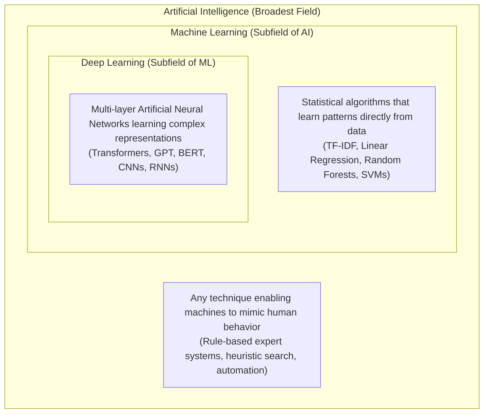
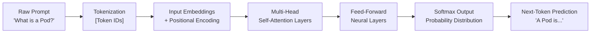
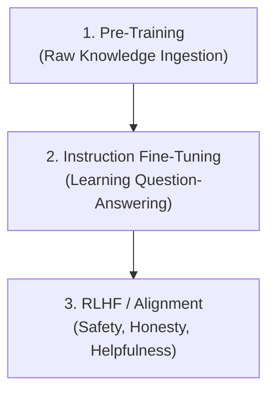
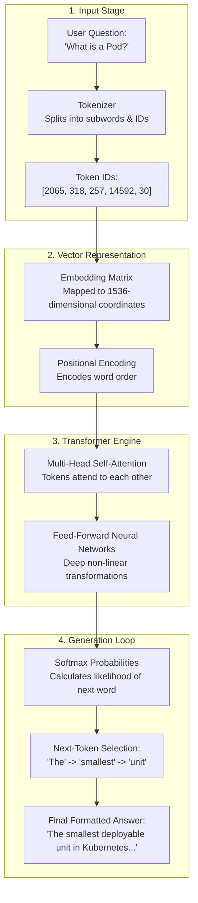

# How Large Language Models (LLMs) Work — A Technical Guide for KubeCoach

> **Audience:** Final-year MCA / Computer Science students preparing for DevOps, AI engineering, and technical vivas.  
> **Context:** Explaining modern Generative AI fundamentals through real-world Kubernetes and DevOps examples.

---

## 1. The AI Hierarchy: AI vs. ML vs. Deep Learning

Before understanding Large Language Models, it is essential to understand the three concentric layers of modern computing intelligence:



### 1.1 What is Artificial Intelligence (AI)?
Artificial Intelligence is the broad engineering discipline of creating computing systems capable of performing tasks that typically require human cognition—such as reasoning, decision-making, natural language communication, and pattern recognition.
- **Example in KubeCoach:** An automated assistant that understands what a student is asking about Kubernetes objects and provides a helpful, step-by-step diagnostic guide.

### 1.2 What is Machine Learning (ML)?
Machine Learning is a subset of AI where systems are not explicitly programmed with hardcoded `if/else` logic for every situation. Instead, algorithms are trained on datasets to discover mathematical relationships and make predictions on unseen data.
- **Example in KubeCoach:** In Day 4, we implemented TF-IDF and Cosine Similarity. The algorithm counted word frequencies across all Kubernetes documentation records to statistically match queries (like *"network service for pods"*) without hardcoded string matching.

### 1.3 What is Deep Learning (DL)?
Deep Learning is a specialized subfield of Machine Learning based on **Deep Artificial Neural Networks**—architectures inspired by biological brains consisting of dozens or hundreds of stacked layers of artificial neurons. Deep learning extracts high-level, abstract features automatically from raw inputs without requiring manual feature engineering.
- **Example in KubeCoach:** A deep neural network reading raw Kubernetes YAML manifests, Helm templates, and Prometheus cluster logs to identify subtle misconfigurations that no simple keyword search could catch.

---

## 2. Why Deep Learning Outperformed Hand-Written Rules

In the early decades of computing, software relied on **expert systems**—vast collections of human-written rules:
```python
# Old Rule-Based Approach (Fragile)
if "pod" in user_query and "error" in user_query:
    return "Check kubectl describe pod"
elif "crash" in user_query and "loop" in user_query:
    return "Inspect CrashLoopBackOff"
```

### Why Rules Failed for Complex Data:
1. **Language Combinations are Infinite:** A student might ask:
   - *"Why is my container restarting repeatedly?"*
   - *"My pod status says CrashLoopBackOff, what does that mean?"*
   - *"How do I fix exit code 137 in Kubernetes?"*  
   Writing rules for every possible wording, synonym, typo, and sentence structure is impossible.
2. **Context and Ambiguity:** In Kubernetes, the word *"Service"* can mean a networking object (`kind: Service`), a systemd daemon on the Linux node, or a cloud provider's managed database service. Hand-crafted rules cannot resolve polysemy (words with multiple meanings) based on surrounding words.
3. **Automatic Representation Learning:** Deep Learning learns dense mathematical representations directly from millions of text examples. Instead of an engineer writing rules for grammar, syntax, and Kubernetes concepts, deep neural networks discover these hierarchical structures automatically.

---

## 3. How Text Becomes Numbers: Tokenization

Computers cannot process letters, words, or sentences directly; they can only perform mathematical operations (matrix multiplication, addition) on numbers.

### 3.1 What is a Token?
Tokenization is the process of breaking down raw text into smaller numerical units called **tokens**. A token can be a word, a sub-word, a syllable, or even individual punctuation marks.

```text
Sentence: "kubectl get pods -n kube-system"
Tokens:   ["kube", "ctl", " get", " pods", " -", "n", " kube", "-", "system"]
Token IDs: [15423,  891,   1205,   9842,    485, 301, 15423,  485,  4219]
```

### 3.2 Sub-Word Tokenization (Byte-Pair Encoding)
Modern LLMs use **Byte-Pair Encoding (BPE)** or similar sub-word algorithms:
- Common words like `"deployment"` or `"service"` receive their own single token ID.
- Rare or compound words like `"HorizontalPodAutoscaler"` are split into known sub-words: `["Horizontal", "Pod", "Auto", "scaler"]`.
- This ensures the model never encounters an *"Out of Vocabulary"* error—even completely new CLI flags or student typos can be represented by assembling sub-word tokens.

---

## 4. What Are Embeddings? Representing Meaning in Space

Once text is converted to token IDs, each token ID is mapped to a high-dimensional continuous vector called an **Embedding**.

### 4.1 Concept Coordinates
Imagine a 2D map where similar cities are close to each other. An embedding is a high-dimensional coordinate space (often 768, 1536, or 4096 dimensions) where words and concepts with similar semantic meanings are placed close together mathematically.

```text
Vector space geometry:
Distance("Pod", "Container") < Distance("Pod", "Database")
Vector("Deployment") - Vector("ReplicaSet") ≈ Vector("Controller")
```

### 4.2 Why Embeddings Are Revolutionary for KubeCoach
In Day 2 and Day 4, our search used keyword overlap and TF-IDF:
- If a student asked: *"How do I expose my app to the internet?"*, TF-IDF looks for the literal words `"expose"`, `"app"`, `"internet"`.
- If the official documentation page only says: *"An Ingress manages external HTTP routing to Services"*, TF-IDF might give a low score because the word `"internet"` is not explicitly repeated.
- **Embeddings solve this:** The embedding for `"internet access"` is geometrically very close to `"external HTTP ingress"`. The model understands the **meaning**, not just the characters.

---

## 5. The Transformer Architecture & The Attention Mechanism

Introduced in the landmark 2017 Google paper *"Attention Is All You Need"*, the **Transformer** is the core architecture powering GPT-4, Gemini, Claude, and LLaMA.



### 5.1 What is Self-Attention?
In older Recurrent Neural Networks (RNNs), text was processed sequentially, word by word, from left to right. By the end of a long paragraph, the network forgot the beginning.

**Self-Attention allows every token to examine and connect to every other token simultaneously**, regardless of their distance in the sentence.

#### Kubernetes Example of Attention in Action:
Consider this sentence:
> *"The **Deployment** created three replicas of the nginx workload because **its** configuration requested high availability."*

What does the word **"its"** refer to? The container? The replica? The node? Or the Deployment?
- Through self-attention weights, the token **"its"** pays strong mathematical attention to **"Deployment"**.
- The model calculates dynamic attention scores:
  $$\text{Attention}(Q, K, V) = \text{softmax}\left(\frac{QK^T}{\sqrt{d_k}}\right)V$$
  Where:
  - **Query ($Q$):** What a word is looking for.
  - **Key ($K$):** What a word offers or represents.
  - **Value ($V$):** The actual semantic content passed forward.

---

## 6. How LLMs Generate Text: Next-Token Prediction

At its mathematical foundation, an LLM is a **probabilistic next-token prediction engine**.

When given a prompt, the model does not write an entire paragraph in a single step. It calculates a probability distribution over its entire vocabulary (e.g., 50,000+ tokens) for what the very next token should be:

```text
Prompt: "In Kubernetes, the smallest deployable unit is a"

Model Output Probabilities:
- " Pod"         -> 94.2%  <-- Selected
- " container"   ->  3.8%
- " node"        ->  1.1%
- " namespace"   ->  0.4%
- " deployment"  ->  0.3%
- " banana"      ->  0.000001%
```

Once `" Pod"` is selected, it is appended to the prompt, and the model runs again to predict the next word:
- `In Kubernetes, the smallest deployable unit is a Pod` $\rightarrow$ predicts `"."`
- `In Kubernetes, the smallest deployable unit is a Pod.` $\rightarrow$ predicts `" It"`
- `In Kubernetes, the smallest deployable unit is a Pod. It` $\rightarrow$ predicts `" represents"`

This autoregressive loop continues until the model predicts a special `<EOS>` (End of Sequence) stop token.

---

## 7. The Three Stages of Training an LLM

Creating a helpful assistant like KubeCoach requires three progressive training phases:



| Phase | What Happens | Kubernetes Analogy |
|---|---|---|
| **1. Pre-Training** | The model reads trillions of tokens of raw web text, documentation, books, and code. It learns grammar, world facts, and syntax by predicting masked words. | A student reading all of GitHub and Kubernetes documentation cover to cover, but without knowing how to answer exam questions politely. |
| **2. Instruction Tuning (SFT)** | The model is fine-tuned on curated pairs of prompts and ideal responses: `{"prompt": "How do I list pods?", "response": "Use kubectl get pods."}`. | A mentor training the student with interview question-and-answer pairs. |
| **3. RLHF (Human Feedback)** | Human reviewers rank model answers. A reward model is trained, and Reinforcement Learning aligns the model to be honest, helpful, and refuse harmful instructions. | A senior DevOps engineer grading the student's answers, penalizing dangerous commands like `rm -rf /` or unverified cluster deletions. |

---

## 8. Fundamental Limitations of LLMs (Crucial for DevOps)

While powerful, Large Language Models suffer from four structural limitations that make tools like KubeCoach and RAG (Retrieval-Augmented Generation) essential:

### 8.1 Hallucinations (Confabulation)
Because LLMs predict probable tokens rather than checking factual databases, they can generate authoritative-sounding answers that are factually false.
- **Dangerous Example in Kubernetes:** If asked *"How do I automatically repair dead nodes in Minikube?"*, an LLM might invent a plausible-sounding command:
  `kubectl node repair --auto --force`
  *(This flag does not exist in Kubernetes and will fail in production).*
- **How KubeCoach Solves This:** In Days 7–10, we will ground answers using **RAG** against verified official documentation records.

### 8.2 Context Window
An LLM can only process a finite number of tokens in a single request (its context window, e.g., 8K, 32K, or 128K tokens).
- You cannot pass the entire 500-page official Kubernetes documentation website into a single prompt.
- We must chunk, index, and retrieve only the most relevant pages.

### 8.3 Knowledge Cutoff
LLM parameters are frozen after training completes.
- If Kubernetes releases a new API version (e.g., deprecating `v1beta1/Ingress` or introducing Gateway API features), a pre-trained model cannot know about it unless updated through external retrieval or retraining.

### 8.4 Cost and Latency Per Token
Every token passed into and generated by an LLM consumes GPU memory and compute cycles. For real-time DevOps tools, efficient prompt design and caching are critical to avoid high latency and cloud expenses.

---

## 9. Visual LLM Pipeline Architecture



### Explanation of the Diagram:
1. **Input Stage:** The student's plain-English question enters the tokenizer and is transformed into discrete integer token IDs.
2. **Vector Representation:** Token IDs are projected into continuous geometric embeddings. Positional encodings are added so the network knows the sequential order of words.
3. **Transformer Engine:** In the core Transformer blocks, self-attention computes relationships between all tokens simultaneously, building rich contextual understanding.
4. **Generation Loop:** The final layer calculates vocabulary-wide probabilities to predict the next word. The selected token feeds back into the prompt until a complete, helpful explanation is produced.

